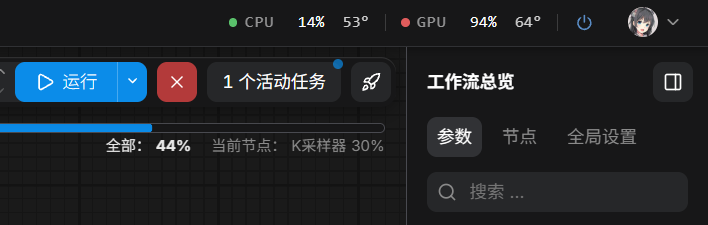
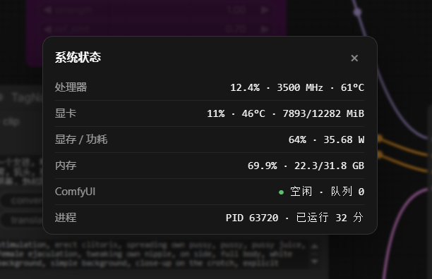

# ComfyUI Vitals

English | [简体中文](README.md)

Shows CPU, GPU and queue status in the ComfyUI top bar, with restart and shutdown controls.



Click the CPU or GPU block in the top bar to open the system panel.



## Features

- CPU usage and temperature, GPU usage and temperature, always visible in the top bar. The status dot is green below 70% load, orange above 70%, red above 90%.
- The system panel shows CPU clock, VRAM usage, power draw, memory, generation queue, process ID and uptime.
- Power button: click to restart ComfyUI, hold for 2 seconds to shut it down. Both actions ask for confirmation.
- Restart is handled by a separate bootstrap process. The old process exits and releases the port, then a new instance starts about 3 seconds later. The page reloads itself.
- Interface text follows the ComfyUI language setting (Chinese or English) and falls back to the browser language.
- Polls every 2 seconds. A failed request keeps the previous frame instead of showing dashes.

## Installation

```
cd ComfyUI/custom_nodes
git clone https://github.com/Carpenter-MK1/ComfyUI-Vitals.git
```

Install the dependency. Portable build:

```
python_embeded\python.exe -m pip install -r custom_nodes\ComfyUI-Vitals\requirements.txt
```

Standard install:

```
pip install -r custom_nodes/ComfyUI-Vitals/requirements.txt
```

Restart ComfyUI afterwards.

## CPU temperature

psutil cannot read CPU temperature on Windows. The ACPI thermal zone reports case ambient temperature and does not move under load. This plugin reads the sensor through LibreHardwareMonitor.

1. Download and unpack [LibreHardwareMonitor](https://github.com/LibreHardwareMonitor/LibreHardwareMonitor)
2. Run it as administrator, open Options → Remote Web Server → Run, keep port 8085
3. The plugin requests `http://127.0.0.1:8085/data.json` every 2 seconds and connects on its own. No ComfyUI restart needed.

When LibreHardwareMonitor is not running, the plugin falls back to the `root/LibreHardwareMonitor` WMI namespace. If neither source is available, the top bar shows a dash for temperature and the panel explains what is missing.

To start LibreHardwareMonitor at logon with administrator rights:

1. Right-click `enable_lhm_autostart.cmd` and choose "Run as administrator". Windows shows one UAC prompt.
2. The script looks for `LibreHardwareMonitor.exe` in this order: the `-ExePath` argument, the `LHM_EXE` or `LHM_PATH` environment variable, the running instance, an already registered task with the same name, common install directories.

If the executable lives somewhere unusual, pass the path:

```
enable_lhm_autostart.cmd "D:\Tools\LibreHardwareMonitor\LibreHardwareMonitor.exe"
```

The script registers a logon task that runs with highest privileges and writes the executable it used to `setup_lhm_task.log` next to the script.

## HTTP API

| Method | Path | Description |
| --- | --- | --- |
| GET | `/sysmon/stats` | Current metrics as JSON |
| POST | `/sysmon/restart` | Restart ComfyUI |
| POST | `/sysmon/shutdown` | Shut down ComfyUI |

The last two endpoints terminate the server. They accept requests from `127.0.0.1` and `::1` only and return 403 for anything else.

## Layout

```
__init__.py               registers the web directory and mounts the routes
sysmon.py                 metric collection, restart and shutdown endpoints
restart_boot.py           bootstrap process that starts the new instance after the port is free
web/sysmon.js             top bar, system panel and confirmation dialogs
setup_lhm_task.ps1        registers the logon task for LibreHardwareMonitor
enable_lhm_autostart.cmd  entry point for the task, requires administrator rights
```

## Compatibility

- Developed and tested on Windows. On Linux and macOS CPU usage, memory and the nvidia-smi GPU metrics are available. CPU temperature is not.
- GPU metrics come from `nvidia-smi`. AMD and Intel users see "No NVIDIA GPU detected" in the panel.
- The top bar is inserted next to the user avatar or login button in the top right corner, based on the current DOM structure of the ComfyUI frontend. If a frontend change removes that anchor, the bar falls back to a floating pill in the top right corner.

## Known limitations

- After a restart the stdout of the new process goes to `ComfyUI/user/sysmon/restart.log`. Check that file first when the server does not come back.
- Shutting down does not schedule a restart. Start ComfyUI again manually.
- CPU clock comes from `psutil.cpu_freq()`. Some platforms report the base clock only.

## License

MIT
