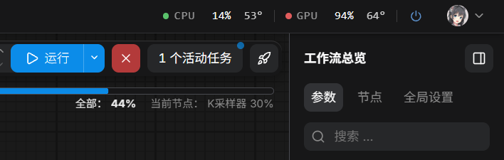
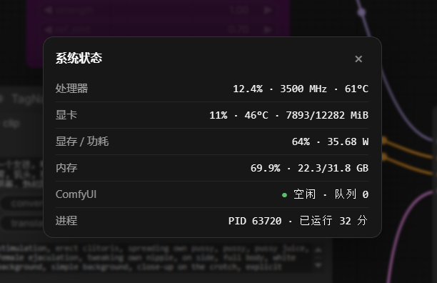

# ComfyUI Vitals

[English](README.en.md) | 简体中文

在 ComfyUI 顶栏显示 CPU、GPU 与队列状态，并提供重启、关闭两个操作。



点击顶栏的 CPU 或 GPU 区域，展开系统状态面板。



## 功能

- 顶栏常驻 CPU 使用率与温度、GPU 使用率与温度，状态点按负载变色（低于 70% 绿色，70% 以上橙色，90% 以上红色）
- 系统状态面板显示 CPU 频率、显存占用、功耗、内存、生成队列、进程 PID 与运行时长
- 电源键：单击重启 ComfyUI，长按 2 秒关闭 ComfyUI，两者均需二次确认
- 重启由独立引导进程完成。旧进程先退出并释放端口，约 3 秒后拉起新实例，页面自动刷新
- 界面文案跟随 ComfyUI 的语言设置（中文或英文），没有设置时按浏览器语言判断
- 每 2 秒轮询一次。接口请求失败时保留上一帧数据，不闪「—」

## 安装

```
cd ComfyUI/custom_nodes
git clone https://github.com/Carpenter-MK1/ComfyUI-Vitals.git
```

安装依赖。便携版环境：

```
python_embeded\python.exe -m pip install -r custom_nodes\ComfyUI-Vitals\requirements.txt
```

标准环境：

```
pip install -r custom_nodes/ComfyUI-Vitals/requirements.txt
```

安装完成后重启 ComfyUI。

## CPU 温度

Windows 下 psutil 读不到 CPU 温度，ACPI 热区返回的是机箱环境温度，满载也不变化。本插件使用 LibreHardwareMonitor 读取。

1. 下载并解压 [LibreHardwareMonitor](https://github.com/LibreHardwareMonitor/LibreHardwareMonitor)
2. 以管理员身份运行，打开 Options → Remote Web Server → Run，端口保持 8085
3. 插件每 2 秒请求一次 `http://127.0.0.1:8085/data.json`，检测到后自动接入，无需重启 ComfyUI

LHM 未运行时，插件退到 `root/LibreHardwareMonitor` WMI 命名空间读取；两者都不可用时，顶栏温度显示「—」，面板底部给出提示。

如需登录后自动以管理员身份启动 LHM：

1. 编辑 `setup_lhm_task.ps1` 第 6 行，把 `$exe` 改成本机 LHM 的实际路径
2. 右键 `enable_lhm_autostart.cmd`，选择「以管理员身份运行」，只弹一次 UAC

脚本注册一个登录时触发、以最高权限运行的计划任务。执行结果写入同目录的 `setup_lhm_task.log`。

## 接口

| 方法 | 路径 | 说明 |
| --- | --- | --- |
| GET | `/sysmon/stats` | 当前指标 JSON |
| POST | `/sysmon/restart` | 重启 ComfyUI |
| POST | `/sysmon/shutdown` | 关闭 ComfyUI |

后两个接口会终止服务，只接受来自 `127.0.0.1` 与 `::1` 的请求，其他来源返回 403。

## 目录结构

```
__init__.py               注册 Web 目录，挂载路由
sysmon.py                 指标采集、重启与关闭接口
restart_boot.py           重启引导进程，等端口释放后拉起新实例
web/sysmon.js             顶栏、状态面板与确认框
setup_lhm_task.ps1        注册 LHM 登录自启计划任务
enable_lhm_autostart.cmd  计划任务的入口，需管理员权限运行
```

## 兼容性

- 主要在 Windows 上开发和验证。Linux 与 macOS 可使用 CPU 占用、内存与 nvidia-smi 提供的 GPU 指标，CPU 温度不可用。
- GPU 指标来自 `nvidia-smi`。AMD 与 Intel 显卡用户在面板中看到「未检测到 NVIDIA 显卡」。
- 顶栏按 ComfyUI 前端现有 DOM 结构插入，位置在右上角用户头像或登录按钮左侧。前端改版后若找不到挂载点，退化为右上角悬浮条。

## 已知限制

- 重启后新进程的 stdout 写入 `ComfyUI/user/sysmon/restart.log`，启动失败时先查这个文件。
- 关闭 ComfyUI 后不会自动重启，需要手动运行启动脚本。
- CPU 频率来自 `psutil.cpu_freq()`，部分平台只返回基频。

## 许可

MIT
